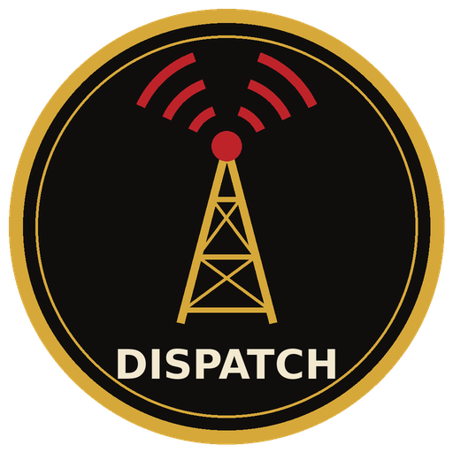

<p align="center"></p>

# Dispatch Console

A Windows PC radio dispatch console for the **Motorola XTL5000 consolette**, in the style of a full-size dispatch
console. It keys the radio with real **tone remote control (TRC)** audio and controls and reads the radio over
**SB9600** through a RIB, so one PC can select channels, see what the radio's display shows, talk, page and record.

Built for a fire department's own dispatch position, and shared so other small agencies, hobbyists and
radio clubs can use it. Brand it with your department's name and logo without touching the code.

> **Not Motorola software.** This is an independent open-source project. It is not affiliated with, endorsed by or
> derived from Motorola Solutions, and it is not MCC 5500 / MCC 7500 software. Motorola, XTL and MCC are trademarks of
> their owners and are used here only to describe compatible hardware.

## Features

- **Tone remote transmit** down the consolette's wireline: high-level guard, function tone, low-level guard, voice,
  alert tones (steady, beeper, hi-lo, sweep) and two-tone (Quick Call II) paging with a paging queue.
- **SB9600 control and readback** through a RIB: channel and zone select with closed-loop confirmation, HOME, monitor,
  scan, nuisance delete, the radio's own display text, and indicator lights (TX, RX, MON, SCAN, DIR...).
- **Full channel names**: the 8-character radio label (`CITY FD`) is shown with its full name (`City Fire Department`).
- **Codeplug import** from a Motorola CPS CSV export: zones, channels, receive-only personalities, scan list and
  priorities.
- **Safety gates**: will not transmit on receive-only channels, during a channel change, or when the radio is on a
  different channel than the console; PTT timeout; Escape = STOP ALL; transmit stops if the console stops.
- **Recording and instant recall** of every received and transmitted call (WAV + daily index), with automatic clean-up.
- **Footswitch** support (USB keyboard-type pedal, game-controller pedal, or a switch on a COM port), global hotkeys
  that work while a CAD or softphone has focus.
- **Operating modes**: Live, Receive only, and a Test mode with a simulated radio for training and setup.
- **Themes and layouts**: several colour themes (including night / dark-adapted and high contrast), interface scaling,
  Full and Compact layouts for small screens.
- **Built-in self-test** (`Verify.cmd`) covering the tone timing, SB9600 parsing, codeplug import and the main window.

## What you need

| Item | Notes |
|---|---|
| Motorola XTL5000 consolette | W7 control head; developed and tested with the W7. |
| Tone remote board (PLN1687) | For TRC transmit audio. Set the **No Mode Select** tone table for codeplugs with more than 8 channels. |
| RIB (RLN4008 or compatible) | RS-232 to SB9600 bridge, on a COM port (motherboard or USB serial). |
| Windows PC | Windows 8 or later (Windows 7 with .NET Framework 4.x installed also works). Builds with the C# compiler built into .NET Framework 4.x; no Visual Studio needed. |
| Audio | A sound output for TX audio to the TRC line, and an input for receive audio. Onboard 7.1 audio can be split; see `HARDWARE_SETUP.md`. |

You need a valid license for the frequencies you transmit on.

## Quick start

1. Download the repository (**Code > Download ZIP**), right-click the zip > **Properties** > **Unblock**, then extract it.
2. Run **`Verify.cmd`**. It compiles the self-test with the Windows .NET Framework compiler and runs every check. It
   must end with two PASS lines.
3. Edit **`branding\brand.ini`** with your department name (and drop in your own `logo.png` / `app.ico` if you like).
4. Put your codeplug in **`cps\`** (see below), or start with the example to try things out in Test mode.
5. Run **`Build_And_Run.cmd`**. It builds `build\DispatchConsole.exe` and starts it. Afterwards use
   **`START_CONSOLE.cmd`**, or **`Create_Desktop_Shortcut.cmd`** for a desktop shortcut.
6. Follow **`HARDWARE_SETUP.md`** to wire the consolette and set levels, and start in **Receive only** until
   everything checks out.

## Branding your department

Everything department-specific lives in `branding/`:

| File | What it does |
|---|---|
| `brand.ini` | Department name, short name, window title, motto, "established" line, logo and icon file names, and the settings folder name under `C:\ProgramData`. |
| `logo.png` | Shown in the header, splash screen and About box. Square, transparent PNG, 512 px or larger. |
| `app.ico` | The program and window icon (used at build time for the .exe). |

You can edit `build\branding\brand.ini` and restart the console without rebuilding. The **Black & Gold** theme is
the default; pick another (or build a Custom one) under Settings > Layouts and themes.

## Your codeplug

The repo ships a **fictional example codeplug** (`cps/Example_XTL5000_Channels.csv`, 59 channels in 6 zones) so the
console and its self-test work out of the box. Its local channels and frequencies are made up; **never program a radio
from it**.

To use your own radio, export the **Zone Channel Assignment** and **Scan List** features from CPS to CSV, then either
save it over `cps/Example_XTL5000_Channels.csv` before the first run, or use **Console > Import CPS codeplug** at any
time. Put your channels' full names in `cps/channel_names.csv` (`RadioText,FullName`). Details, including the TRC tone
table and the W7 key map, are in [`CPS_INTEGRATION.md`](CPS_INTEGRATION.md).

## Documentation

| Document | Contents |
|---|---|
| [`USER_GUIDE.md`](USER_GUIDE.md) | Install, operating modes, the main screen, keyboard, paging, recording, footswitch, settings and safety. |
| [`HARDWARE_SETUP.md`](HARDWARE_SETUP.md) | Wiring, TRC board switches, audio levels, SB9600 / RIB, footswitch, COM ports, recovery. |
| [`CPS_INTEGRATION.md`](CPS_INTEGRATION.md) | How a CPS codeplug export maps to the console, channel selection, paging. |
| [`OPERATOR_CARD.md`](OPERATOR_CARD.md) | One-page card for the console position. |
| [`CHANGELOG.md`](CHANGELOG.md) | Changes in every version. |
| [`SOURCES.md`](SOURCES.md) | Protocol and hardware references. |

## Project layout

```
*.cs                    Console source (C# 5, WinForms, .NET Framework 4 - builds with the csc.exe in Windows)
Build_And_Run.cmd       Build build\DispatchConsole.exe and start it
Verify.cmd              Build and run the self-test (ConsoleVerify.cs)
branding/               brand.ini, logo.png, app.ico
cps/                    Example CPS export and channel names
resources.map, channels.map, audio.settings   First-run defaults
```

The code deliberately sticks to C# 5 and ASCII-only source so it compiles with the compiler that ships inside Windows.
Please keep it that way in pull requests.

## Status

Version 1.0.2. SB9600 control, TRC transmit, receive audio and recording have been checked on a development
XTL5000 / W7 / PLN1687 / RIB bench. MDC1200 decoding is not implemented. Other Motorola consolettes and control heads
may need their SB9600 key and indicator codes learned (Settings > Engineering > SB9600 monitor / LEARN).

**Test thoroughly before using it for live dispatch.** This software is provided as-is, without warranty; you are
responsible for verifying it in your own system.

## Credits

This console would not exist without other people's open protocol research:

- **W3AXL**: [RadioConsole2](https://github.com/W3AXL/RadioConsole2), the open-source dispatch console whose SB9600
  work taught us the W-series head codes, SBEP display and indicator messages and BUSY handling, and
  [XTL-SB9600-Playground](https://github.com/W3AXL/XTL-SB9600-Playground) (CRC test vectors, RIB wiring, XTL commands).
- **Paul Banks**: the original [SB9600 / SBEP research](https://paulbanks.org/projects/sb9600/) those tools build on.
- **Motorola** consolette and SB9600 protocol manuals, and the [W9CR wiki](https://wiki.w9cr.net/) for hosting the
  public SB9600 manual.

The console's code is original; facts were learned from these sources and re-implemented. Full credits are in
[`SOURCES.md`](SOURCES.md).

## License

Copyright (c) 2026 Mike Steege.

Dispatch Console is free software: you can redistribute it and/or modify it under the terms of the
[GNU General Public License v3.0](LICENSE). In short: anyone may use, study, change and share it, but if you
distribute a changed version you must share its source code under the same license and keep the copyright notice.
It comes with no warranty.
